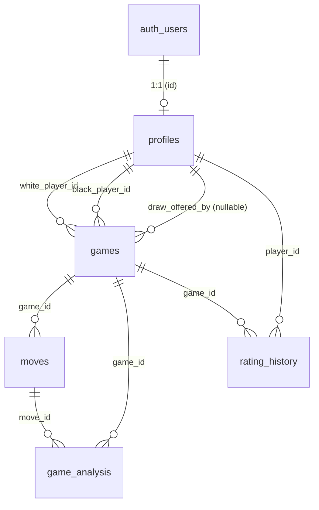

# PROJECT HANDOVER & VIVA PREPARATION DOCUMENT

## Chess Web App — based only on code that actually exists in this repository

**Verification note:** Everything below was checked against the real files. When something is planned-but-not-implemented, partially working, or unverifiable from code alone (e.g., external Supabase/Google settings), it is explicitly flagged.

**Legend used throughout:**
- **Verified** = confirmed by reading the actual source file
- **Gap / Incomplete** = designed or discussed but not finished in code
- **Unverified** = cannot be confirmed from the repository alone

---

# PART 1 — PROJECT OVERVIEW

## 1.1 What problem does the project solve?

Chess.com and Lichess are huge commercial platforms. This project is a **self-built, full-stack chess website** where a player can:

- Play a live game against a friend using only a shareable link (no app install, no matchmaking server)
- Practice against a computer opponent
- Solve tactics puzzles
- Track rating, win/loss statistics, and review finished games with a chess engine

For the college evaluation, it also demonstrates a real multi-user, database-backed, real-time web product rather than a simple to-do or form app.

## 1.2 Target users

1. College students who want to play chess with a friend quickly (invite via link)
2. Beginners who want to practice against a bot or solve puzzles
3. Signed-up players who care about rating and a leaderboard (Elo system)

## 1.3 What the application does

A **Next.js (React)** website backed by **Supabase** (Postgres database + authentication + live updates).

- Visitors can browse the public landing page, puzzles, and bot mode
- Signed-up users can create a game, share the room link, play live with server-validated moves, use chess clocks, resign or offer draws, gain/lose Elo rating, and analyze finished games with Stockfish running in the browser
- Google users are sent through a one-time username onboarding step

## 1.4 Major features (all verified in code)

| # | Feature | Plain-English explanation | Where it lives (verified) |
|---|---------|---------------------------|---------------------------|
| 1 | Email sign-up / sign-in | User picks a username + email + password, or signs in with username **or** email | `app/sign-up/page.tsx`, `app/sign-in/page.tsx` |
| 2 | Google sign-in | "Sign in with Google" button; returns via `/auth/callback` | `components/auth/GoogleButton.tsx`, `app/auth/callback/route.ts:13-42` |
| 3 | Username onboarding | Google users get an auto-generated name and must pick a real one (3–20 chars, `[a-z0-9_]`), changeable once per 30 days | `app/onboarding/username/page.tsx`, `change_username` in `supabase/schema.sql:167-217` |
| 4 | Live multiplayer by invite link | Player A creates a game → gets a 6-char room-code URL → Player B opens it, joins → game becomes "active" with a 3-2-1 countdown | `app/play/new/page.tsx`, `app/play/[roomCode]/page.tsx`, `app/api/games/*` |
| 5 | Server-validated moves | Every move is checked on the server with the `chess.js` rules engine (legal move? your turn? game active?) before it is stored | `app/api/games/[id]/move/route.ts:36-78` |
| 6 | Real-time sync | When one player moves, the other player's board updates instantly via Supabase Realtime, not manual refresh | `hooks/useGameRealtime.ts:78-98`, `supabase/schema.sql:405-406` |
| 7 | Chess clocks | Each side has remaining time; moving charges elapsed time and may add an increment; running out = timeout loss | Move route lines 43–70; `hooks/useClock.ts`; `components/game/ClockDisplay.tsx` |
| 8 | Resign and draw offers | Resign = loss. Draw can be offered, accepted, or declined | `app/api/games/[id]/resign/route.ts`, `app/api/games/[id]/draw-offer/route.ts`, `components/game/GameControls.tsx` |
| 9 | Elo rating (server-side only) | After a rated game ends, a database function recalculates both players' ratings and writes rating history. Clients cannot write ratings | `supabase/schema.sql:409-481` (`apply_elo_update`) |
| 10 | Dashboard | Rating, games played, wins, losses/draws, rating-over-time chart, last 10 completed games | `app/dashboard/page.tsx`, `components/dashboard/*` |
| 11 | Leaderboard | Top 50 players by rating (signed-in users only) | `app/leaderboard/page.tsx:43-55` |
| 12 | Public member profiles | `/member/username` shows anyone's public stats | `app/member/[username]/page.tsx` |
| 13 | Settings | Change display name (auto-saves), avatar URL, username (RPC), email, password | `app/settings/profile/page.tsx` |
| 14 | Play vs Bot | 4 difficulties (custom minimax AI in a Web Worker), color choice, casual or timed, undo, resign. Runs 100% in the browser — **nothing is saved to the database** | `app/play/bot/page.tsx`, `lib/chess/botEngine.ts` |
| 15 | Puzzles | 15 built-in puzzles plus an optional "daily puzzle" fetched from Lichess's public API. Stats saved in `localStorage` only | `app/puzzles/page.tsx`, `lib/chess/puzzles.ts:230-256` |
| 16 | Post-game analysis | Step through moves and "Run analysis" — Stockfish (WASM, in-browser) evaluates each position and labels moves best/good/inaccuracy/mistake/blunder with an eval bar | `app/analysis/[gameId]/page.tsx`, `lib/chess/analyzeGame.ts`, `lib/chess/stockfishWorker.ts` |
| 17 | Theme and sound toggles | Light/dark mode (no flash on load), Web Audio beeps for move/capture/check | `components/ui/ThemeToggle.tsx`, `lib/theme.ts`, `lib/sounds.ts`, inline script in `app/layout.tsx:17-21` |
| 18 | Hardened production server | Custom Node server + nginx config with timeouts and connection limits (Slowloris defense) | `server.js`, `nginx/chess-app.conf` |

## 1.5 Five important user workflows (step by step)

### Workflow A — Sign up and land on the dashboard

1. Open `/sign-up` → type a username (live "available/taken" check via DB RPC `username_available`), email, password ≥ 6 chars (`app/sign-up/page.tsx:28-51`)
2. Click "Create account" → `supabase.auth.signUp` sends metadata `{ username }` (lines 52–56)
3. A **database trigger** (`handle_new_user`, `supabase/schema.sql:63-123`) creates the `profiles` row automatically
4. If email confirmation is off → straight to `/dashboard`; if on → "check your email" message (lines 63–68)
5. Dashboard loads the account through the `get_my_account` RPC (`hooks/useMyAccount.ts:36`)

### Workflow B — Play a live game with a friend (flagship feature)

1. Sign in → `/play/new` → pick a time control (3/5/10/15|10) and rated or casual → "Create game" (`app/play/new/page.tsx:34-58`)
2. `POST /api/games` creates a row with a random 6-character room code (`app/api/games/route.ts:12-47`)
3. You land in the **waiting room** showing the share URL and "Copy link" (`app/play/[roomCode]/page.tsx:351-382`)
4. Friend opens the link (must be signed in) → "Join game" → `POST /api/games/:id/join` sets them as Black, status `active`, `started_at = now+3s` (`join/route.ts:45-55`)
5. Both clients show a 3-2-1 countdown (`play/[roomCode]/page.tsx:143-168`), then pieces become clickable on your turn
6. Each move: optimistic local preview → `POST /api/games/:id/move` → server validates → row inserted in `moves` + `games` updated → Realtime event updates the opponent (`useGameRealtime.ts:81-93`)
7. Game ends (checkmate / stalemate / draw rule / timeout / resign / agreed draw) → status `completed` + result stored → if rated, `apply_elo_update` updates both profiles + `rating_history` → `GameEndModal` appears (`GameEndModal.tsx:27-67`)

### Workflow C — Play vs bot (no account data touched)

1. `/play/bot` → choose difficulty (Novice ~800 → Master ~2200), color (white/black/random), time control → "Start Match" (`app/play/bot/page.tsx:67-87`)
2. You move → `handlePlayerMove` applies it with chess.js in memory (lines 213–271)
3. Bot replies after a simulated 350–750 ms delay via `getBotMoveAsync` in a Web Worker (lines 143–211; worker code `lib/chess/botEngine.worker.ts`)
4. Resign / Undo (undo removes 1 or 2 plies) / game-over modal with "Play Again"
5. **No database rows are created**

### Workflow D — Analyze a finished game

1. Game ends → "View analysis" in the modal → `/analysis/:gameId` (`GameEndModal.tsx:46-49`)
2. Page loads the game + moves from Supabase (RLS: only participants can read) (`analysis/[gameId]/page.tsx:71-101`)
3. Click "Run analysis" → for each move, Stockfish WASM evaluates the position at depth 14 → swing in centipawns classifies the move (`analyzeGame.ts:25-68`)
4. Eval bar + colored labels appear. **Results are shown but not saved** (see gaps)

### Workflow E — Settings and username change

1. Avatar menu → Settings (`components/nav/NavBar.tsx:80-86`)
2. Display name saves automatically after a 600 ms debounce (`settings/profile/page.tsx:90-109`)
3. Username change: format + availability checked in the UI, then the `change_username` RPC enforces the 30-day rule **in the database** (lines 127–150; `schema.sql:167-217`)
4. Email/password changes go through Supabase Auth (`updateUser`, lines 152–186)

---

# PART 2 — TECHNOLOGY STACK

For each technology: what it is (beginner version), why we use it, where it is used, and what breaks if we remove it.

## 2.1 Core runtime and framework

| Technology | Purpose here | Why not do it manually? | Files | If removed |
|---|---|---|---|---|
| **Node.js** | Runs the JavaScript server | Everything is JS end-to-end; no separate backend language | `server.js` | Nothing runs |
| **Next.js 14 (App Router)** | React framework: file-based routing (`app/play/new/page.tsx` = URL `/play/new`), server-side API routes, build tool | Hand-writing routing, bundling, SSR is enormous work | All of `app/`, `next.config.js`, `package.json:21` | No pages, no `/api` routes, no builds |
| **React 18** | Builds the UI as reusable components with state | Manual DOM updates would be unmaintainable | Every `.tsx` under `app/` and `components/` | No UI |
| **TypeScript** | JavaScript with type checking (`interface MoveRow`, etc.) | Catches wrong field names before runtime | Most `.ts`/`.tsx` files; `tsconfig.json` | More runtime bugs; code still runs (Next compiles TS) |

**Beginner note:** "App Router" means each folder under `app/` becomes a URL, each `page.tsx` is what you see, and each `route.ts` is a backend API endpoint.

## 2.2 Backend-as-a-Service: Supabase

| Technology | Purpose here | Why not manual? | Files | If removed |
|---|---|---|---|---|
| **Supabase Postgres** | The database (profiles, games, moves, …) | Running your own Postgres + backups + admin UI is operations work | `supabase/schema.sql`, all queries in pages/routes | No data at all |
| **Supabase Auth** | Email/password + Google OAuth, sessions stored in cookies | Rolling your own auth (hashing, sessions, OAuth) is insecure and huge | `lib/supabase/server.ts`, `lib/supabase/client.ts`; sign-in/up pages | No login system |
| **Supabase Realtime** | Pushes `games`/`moves` row changes to both players' browsers | Would need a WebSockets server + pub/sub written by hand | `hooks/useGameRealtime.ts:81-93`; enabled in `schema.sql:405-406` | Games would need manual refresh; live play dies |
| **Row Level Security (RLS)** | Database-level rules: e.g., "a user can only SELECT their own games" | App-level checks can be bypassed if any query path is missed | Policies in `schema.sql:28-58, 277-306, 322-345, …` | Anyone with the anon key could read others' games |
| **Postgres RPC functions** | SQL functions callable from the client: `username_available`, `change_username`, `get_my_account`, `resolve_username_email`, `apply_elo_update` | Encapsulates complex/privileged logic inside the DB with its own permissions | `schema.sql:130-252, 409-481` | Username rules/Elo would have to move into app code (weaker) |
| **`@supabase/ssr`** | Creates Supabase clients that read/write the **session cookie** (browser ↔ server) | Raw supabase-js doesn't know about Next.js cookies | `lib/supabase/client.ts`, `server.ts` | Server routes couldn't know who is logged in |
| **`@supabase/supabase-js`** | The actual JS SDK that talks to Supabase REST/Auth/Realtime | Writing HTTP clients for each API by hand | Same files + `admin.ts` | No database access |

**Two clients + one admin client (important for viva):**

- **Browser client** (`lib/supabase/client.ts:3-8`): uses the public **anon key** — safe to expose; limited by RLS
- **Server client** (`lib/supabase/server.ts:4-31`): anon key + user's cookie — used in API routes to check `auth.getUser()`
- **Admin client** (`lib/supabase/admin.ts:3-17`): uses the secret **service-role key** that bypasses RLS. Only created inside API routes; returns `null` if the env var is missing and the route falls back to the normal client

## 2.3 Chess logic libraries

| Technology | Purpose | Why manual is worse | Files | If removed |
|---|---|---|---|---|
| **chess.js** | Official chess rules: legal moves, check/checkmate/stalemate/draw detection, FEN/PGN | Implementing castling, en passant, promotion, threefold repetition correctly is a classic multi-week project | `lib/chess/engine.ts`; move route line 36; board line 32 | No move validation anywhere; game-over detection breaks |
| **Custom bot (`botEngine.ts`)** | Minimax + alpha-beta search with piece-square tables, 4 depths | We wrote this ourselves — good viva story | `lib/chess/botEngine.ts` (376 lines), `botEngine.worker.ts` | Bot mode disappears |
| **Stockfish WASM** (`public/stockfish/`) | World-class engine compiled to WebAssembly, runs in the browser | We don't have to write an engine for analysis | `lib/chess/stockfishWorker.ts`, analysis page | "Run analysis" fails (page shows a friendly error, lines 145–147) |

## 2.4 UI libraries

| Technology | Purpose | Files | If removed |
|---|---|---|---|
| **Tailwind CSS** | Utility classes (`flex`, `rounded-2xl`, `dark:`) instead of separate CSS files | `tailwind.config.ts`, `app/globals.css`, every component | All styling gone |
| **lucide-react** | Icons (Bot, Flag, Trophy, …) | NavBar, bot page, puzzles page | Icons missing |
| **framer-motion** | Animations (countdown pop, eval bar spring, puzzle feedback) | `play/[roomCode]/page.tsx:424-429`, `EvalBar.tsx:11-13`, puzzles page | UI still works, less polish |
| **recharts** | Rating line chart on dashboard | `components/dashboard/RatingChart.tsx`, loaded dynamically in `dashboard/page.tsx:15-26` | Chart gone (loaded lazily so it doesn't slow first paint) |
| **clsx + tailwind-merge (`cn`)** | Conditional class names safely merged | `lib/utils.ts:4-6`, used everywhere | Messier `className` code |

## 2.5 Infrastructure / security libraries

| Technology | Purpose | Files | If removed |
|---|---|---|---|
| **`@upstash/ratelimit` + `@upstash/redis`** | Distributed rate limiting (sliding window) shared across server instances | `lib/rateLimit.ts:58-98` | Falls back to per-instance in-memory limiter (`rateLimit.ts:33-49`) — weaker under load |
| **Custom `server.js`** | Production HTTP server wrapping Next, with Slowloris timeouts and per-IP connection caps | `server.js` (whole file) | `npm run start:vanilla` still works but loses hardening |
| **nginx config** | Reverse proxy in front of the app: request-rate limits, connection limits, static caching | `nginx/chess-app.conf` | Would need another way to sit in front of port 3000 |

## 2.6 External services (configuration, not code)

- **Google OAuth** — must be enabled in the Supabase dashboard (cannot be verified from code; button exists at `GoogleButton.tsx`)
- **Lichess public API** — daily puzzle fetch (`puzzles.ts:230-256`); fails gracefully to built-in puzzles

## 2.7 Environment variables (names only — never print values)

From `.env.local.example`:

1. `NEXT_PUBLIC_SUPABASE_URL` — your Supabase project URL (public)
2. `NEXT_PUBLIC_SUPABASE_ANON_KEY` — public key, safe in the browser
3. `SUPABASE_SERVICE_ROLE_KEY` — **secret** admin key; server-only
4. `UPSTASH_REDIS_REST_URL` / `UPSTASH_REDIS_REST_TOKEN` — optional; enable shared rate limiting

Optional for `server.js`: `HOST`, `PORT`, `HEADERS_TIMEOUT_MS`, `REQUEST_TIMEOUT_MS`, `KEEP_ALIVE_TIMEOUT_MS`, `SOCKET_TIMEOUT_MS`, `MAX_CONN_PER_IP`, `MAX_CONN_TOTAL`, `TRUSTED_PROXIES`.

---

# PART 3 — CODEBASE MAP

## 3.1 Folder structure

```
chess-app/
├── app/                    # Every URL of the site (App Router)
│   ├── api/                # Backend endpoints (server-side only)
│   │   └── games/          # Create / lookup / join / move / resign / draw
│   ├── auth/callback/      # Google OAuth return URL
│   ├── analysis/[gameId]/  # Post-game review page
│   ├── dashboard/          # Stats + charts
│   ├── leaderboard/        # Top 50 by rating
│   ├── member/[username]/ # Public profile
│   ├── onboarding/username/# Google users pick a name
│   ├── play/               # new (create), bot, [roomCode] (live game)
│   ├── puzzles/            # Tactics trainer
│   ├── reset-password/     # Email recovery flow
│   ├── settings/profile/   # Profile + account settings
│   ├── sign-in/, sign-up/  # Auth pages
│   ├── layout.tsx          # Root HTML shell + dark-mode anti-flash script
│   ├── page.tsx            # Landing page (feature cards)
│   └── globals.css         # Tailwind + CSS variables (board colors, themes)
├── components/             # Reusable UI pieces (board, nav, game sidebar, ui/)
├── hooks/                  # Reusable React state logic (useAuth, useGameRealtime…)
├── lib/                    # Non-UI logic (chess engines, supabase clients, elo…)
│   ├── chess/              # Rules wrapper, bot, Stockfish, puzzles, captures
│   └── supabase/           # Browser / server / admin clients
├── public/stockfish/       # Stockfish WASM engine served to the browser
├── supabase/
│   ├── schema.sql          # Full fresh-install database schema (source of truth)
│   └── migrations/         # Incremental upgrades for existing databases
├── nginx/chess-app.conf    # Reverse-proxy config for a Linux server
├── server.js               # Hardened production Node server
├── middleware.ts           # Rate limiting for all /api/* calls
├── deploy/                 # ⚠️ EMPTY FOLDER (nothing deployed from here)
└── README.md               # ⚠️ Effectively EMPTY (2 bytes)
```

Also present but not part of the app: `s*.log`, `s*.err` (runtime logs), `.kilo/` (AI-tool plans/worktrees), `body.json` (1-line scratch file), `tsconfig.tsbuildinfo` (build cache).

## 3.2 File responsibility table (important files)

| File path | Responsibility | Key functions/components | Inputs | Outputs | Connects to |
|---|---|---|---|---|---|
| `app/api/games/route.ts` | Create a game | `POST`, `generateRoomCode` (7–10) | JSON `{isRated, timeControlMinutes, timeControlIncrement}` | `{game}` row | `games` table; rate limiter |
| `app/api/games/lookup/[code]/route.ts` | Resolve room code → game (pre-join) | `GET` (9–50) | URL code | `{id?, status, isParticipant}` | `games` table; **withholds id from signed-out users** (46) |
| `app/api/games/[id]/join/route.ts` | Second player joins | `POST` (6–77) | game id in URL | partial game JSON | `games` update; `started_at = now+3s` |
| `app/api/games/[id]/move/route.ts` | Validate + store a move | `POST` (8–144) | `{from, to, promotion}` | `{game, move}` or error | chess.js, `moves`+`games` tables, `apply_elo_update` RPC |
| `app/api/games/[id]/resign/route.ts` | Resign | `POST` (6–55) | — | updated game | `games`, Elo RPC |
| `app/api/games/[id]/draw-offer/route.ts` | Offer/accept/decline draw | `POST` (7–81) | `{action}` | updated game | `games`, Elo RPC |
| `app/auth/callback/route.ts` | OAuth code → session | `GET` (13–42), `safeNext` (6–11) | `code`, `next` | redirect | Supabase auth; `get_my_account` RPC |
| `middleware.ts` | Per-IP API rate limit | `middleware` (20–29) | all `/api/*` requests | pass or 429 | `lib/rateLimit.ts` |
| `lib/rateLimit.ts` | Redis or in-memory sliding window | `rateLimit` 33–49, `ipRateLimit` 101–108, `userRateLimit` 111–118, `callerIp` 128–142 | key, limit, windowMs | boolean allow | Upstash Redis (optional) |
| `lib/supabase/client.ts` | Browser Supabase client | `createClient` | env vars | client | `@supabase/ssr` |
| `lib/supabase/server.ts` | Cookie-aware server client | `createClient` | cookies | client | API routes |
| `lib/supabase/admin.ts` | Service-role (RLS-bypassing) client | `createAdminClient` | secret env | client or null | API routes only |
| `lib/chess/engine.ts` | chess.js wrapper | `createGame` 3–5, `getLegalMoves` 7–9, `makeMove` 11–22, `getGameStatus` 24–31 | FEN / move | Chess instance / status | move route, board, bot page |
| `lib/chess/botEngine.ts` | AI opponent | `evaluateBoard` 104–125, `minimax` 146–201, `getBotMove` 203–280, `getBotMoveAsync` 347–376 | FEN + difficulty | move or null | worker, bot page |
| `lib/chess/stockfishWorker.ts` | Talk to Stockfish WASM | `evaluatePosition` 77–160 | FEN, depth | `{evalCp, mateIn, bestMove}` | analysis flow |
| `lib/chess/analyzeGame.ts` | Classify each move | `analyzeGame` 25–68, `classify` 17–23 | move list | `MoveAnalysis[]` | analysis page |
| `lib/chess/puzzles.ts` | 15 built-in puzzles + Lichess daily | `BUILTIN_PUZZLES` 23–219, `uciToMove` 222–227, `fetchDailyLichessPuzzle` 230–256 | — | puzzle objects | puzzles page |
| `lib/chess/captured.ts` | Replay SANs to find captures | `capturedFromSan` 27–56 | SAN list | pieces lost per side | `useCapturedPieces` hook |
| `lib/elo.ts` | Client-side Elo math (mirrors SQL) | `expectedScore`, `kFactor`, `newRating` | ratings | new rating | **Not called by live game flow** — Elo actually runs in SQL; this file is reference/duplicate |
| `hooks/useAuth.ts` | Who is logged in | `useAuth` 7–26 | session | `{user, isAuthed, loading}` | nearly every page |
| `hooks/useMyAccount.ts` | My profile row (incl. private fields) | `useMyAccount` 24–48 | user | account object | dashboard, settings, nav |
| `hooks/useGameRealtime.ts` | Load game + subscribe to changes | `useGameRealtime` 38–105 | gameId | `{game, moves, loading, refetch}` | live play page |
| `hooks/useUsernameAvailability.ts` | Debounced username check | 17–55, `USERNAME_RE` 6 | username | status | sign-up, onboarding, settings |
| `hooks/usePlyCursor.ts` | Browse move history (keyboard arrows) | 8–56 | ply count | cursor + commands | live game, bot |
| `hooks/useCapturedPieces.ts` | Memoized captured pieces | 17–27 | moves + cursor | `{w,b}` | game pages |
| `hooks/useClock.ts` | Smooth countdown between server updates | 5–30 | server ms + running flag | formatted time | `ClockDisplay` |
| `app/play/[roomCode]/page.tsx` | **The live game UI** | lookup effect 77–100, `handleJoin` 174–188, `handleMove` 190–233, `handleResign` 244–248, `handleDrawOffer` 250–258 | clicks | API calls + rendering | all game components + APIs |
| `app/play/bot/page.tsx` | Bot match UI | `startNewGame` 67–87, `triggerBotMove` 143–211, `handlePlayerMove` 213–271, `handleUndo` 283–300 | clicks | in-memory game | botEngine |
| `components/board/ChessBoard.tsx` | Clickable 8×8 board | `handleSquareClick` 42–77, promotion picker 160–181 | FEN + click | `onMove(from,to,promotion?)` | engine.ts |
| `supabase/schema.sql` | Complete DB schema + policies + functions | see Part 6 | — | database | everything |
| `server.js` | Hardened HTTP server | timeouts 84–91, conn cap 93–115, proxy IP trust 72–82 | HTTP | Next.js handler | nginx |
| `middleware.ts` | API flood protection | see above | requests | allow/429 | rateLimit |

## 3.3 The 18 files to understand first (study in this order)

1. `app/play/[roomCode]/page.tsx` — the heart of the product (497 lines)
2. `app/api/games/[id]/move/route.ts` — where the rules are enforced
3. `supabase/schema.sql` — the whole database design
4. `hooks/useGameRealtime.ts` — how live sync works
5. `components/board/ChessBoard.tsx` — how a click becomes a move
6. `lib/chess/engine.ts` — small wrapper over chess.js (31 lines, read it fully)
7. `app/api/games/route.ts` + `join/route.ts` — game lifecycle
8. `lib/supabase/admin.ts` + `server.ts` + `client.ts` — the three clients (55 lines total)
9. `middleware.ts` + `lib/rateLimit.ts` — abuse protection
10. `app/sign-up/page.tsx` + `app/auth/callback/route.ts` — auth flows
11. `hooks/useAuth.ts` + `useMyAccount.ts` — session and profile
12. `app/play/bot/page.tsx` + `lib/chess/botEngine.ts` — offline mode and AI
13. `app/analysis/[gameId]/page.tsx` + `lib/chess/analyzeGame.ts` — engine review
14. `app/dashboard/page.tsx` + `app/leaderboard/page.tsx` — read-only queries
15. `app/settings/profile/page.tsx` — writes to profiles + RPCs
16. `supabase/migrations/20261020_accounts.sql` — how the schema evolved (great "iteration" story)
17. `server.js` + `nginx/chess-app.conf` — deployment story
18. `app/puzzles/page.tsx` — mostly self-contained client feature

## 3.4 Verified gaps in the "map"

- `deploy/` exists but is **empty** — no deployment scripts (only nginx config under `nginx/`)
- `README.md` contains only 2 bytes — **no project documentation** (bad for evaluation; fix quickly)
- **No test files exist anywhere** (searched `*test*` / `*spec*` — zero results outside dependencies)
- `game_analysis` table is created in SQL but **no code writes to it** (analysis is computed in the browser and discarded)

---

# PART 4 — FRONTEND EXPLANATION

## 4.1 Pages and what each one does

| URL | File | Type | What the user sees |
|-----|------|------|--------------------|
| `/` | `app/page.tsx` | Public | Landing page with 5 feature cards linking to play/bot/dashboard/puzzles/leaderboard |
| `/sign-up` | `app/sign-up/page.tsx` | Public | Username (live check) + email + password, or Google |
| `/sign-in` | `app/sign-in/page.tsx` | Public | Username **or** email + password, forgot-password mode, Google |
| `/reset-password` | `app/reset-password/page.tsx` | Public (email link) | Sets a new password after the recovery link creates a session |
| `/auth/callback` | `app/auth/callback/route.ts` | Server route | Converts Google's code into a session; sends unconfirmed usernames to onboarding |
| `/onboarding/username` | `app/onboarding/username/page.tsx` | Authed | First-time username picker (Google users) |
| `/play/new` | `app/play/new/page.tsx` | Authed | Time-control picker + rated toggle → creates game |
| `/play/[roomCode]` | `app/play/[roomCode]/page.tsx` | Authed (join needs auth) | Waiting room OR full live board with clocks/moves/draw/resign |
| `/play/bot` | `app/play/bot/page.tsx` | Public | Bot setup screen, then full game vs AI |
| `/puzzles` | `app/puzzles/page.tsx` | Public | Puzzle trainer with filters, hints, streak stats (localStorage) |
| `/analysis/[gameId]` | `app/analysis/[gameId]/page.tsx` | Authed (RLS) | Step through a finished game; run Stockfish analysis |
| `/dashboard` | `app/dashboard/page.tsx` | Authed | Stat cards, rating chart, recent games |
| `/leaderboard` | `app/leaderboard/page.tsx` | Authed | Top 50 table |
| `/member/[username]` | `app/member/[username]/page.tsx` | Authed (RLS requires sign-in) | Public profile stats |
| `/settings/profile` | `app/settings/profile/page.tsx` | Authed | Two tabs: profile (name/avatar/username) and account (email/password/sign out) |
| (loading spinners) | `app/loading.tsx`, `dashboard/loading.tsx`, `leaderboard/loading.tsx` | — | Shown by Next while a route loads |

## 4.2 How THIS project uses React concepts

**Components** — Small functions returning JSX. Examples: `ChessBoard` (`ChessBoard.tsx:23`), `MoveList`, `ClockDisplay`, `StatCard`. Most accept a props interface (e.g., `ChessBoardProps` at `ChessBoard.tsx:15-21`: `fen`, `onMove`, `orientation`, `lastMove`, `interactive`). `ChessBoard` is wrapped in `memo` (line 23) so clock ticks don't re-render the whole board.

**State (`useState`)** — Local memory of a page. Example: the live game page holds `lookup`, `optimistic`, `actionError`, `countdownSecs` (lines 37–51). Bot page holds the entire game (`chess` instance, `fen`, `moves`, clocks) in state (lines 39–58).

**Effects (`useEffect`)** — Run after render for side effects: fetching the room lookup (lines 77–100), subscribing to realtime (in the hook), playing sounds when `moves.length` changes (137–141), ticking the countdown (151–164).

**Custom hooks** — Reused logic extracted from pages:

- `useAuth` — polls `getUser()` once, then listens to auth changes (18–20)
- `useMyAccount` — calls the `get_my_account` RPC and exposes `refresh()`
- `useGameRealtime` — initial fetch + Supabase channel subscription; returns `{game, moves, loading, refetch}`
- `usePlyCursor` — history navigation pinned/unpinned from the latest move; keyboard arrows (32–53)
- `useCapturedPieces` — memoized replay of SAN strings to compute captured pieces
- `useClock` — interpolates between server clock updates every 100 ms so the timer looks smooth
- `useUsernameAvailability` — 400 ms debounce, then RPC (41–46)

**Props down / callbacks up** — Parent page owns data; children receive props. E.g., live page passes `onMove={handleMove}` into `ChessBoard`; the board calls it when a legal target square is clicked (`ChessBoard.tsx:58`).

**API calls** — Two styles:

1. `fetch("/api/games/...")` for privileged operations (create/join/move/resign/draw) — see `play/[roomCode]/page.tsx:81, 177, 216, 246, 252`
2. Direct Supabase queries from the browser for read-only, RLS-protected data — e.g., dashboard reads `rating_history` and `games` (51–91), leaderboard reads `profiles` (46–54)

## 4.3 Where input validation and error messages live

| What | Client-side validation | Server/DB validation | Where errors are shown |
|------|------------------------|----------------------|------------------------|
| Username | Regex `USERNAME_RE` (`useUsernameAvailability.ts:6`), length attrs, live RPC check | DB check constraint `profiles_username_format` (`schema.sql:22`) + `change_username` RPC raises exceptions | Red text under the field (`sign-up/page.tsx:114-127`) |
| Email/password | `required`, `type=email`, `minLength={6}` | Supabase Auth rules | `setError(error.message)` (`sign-up/page.tsx:58-60`) |
| Sign-in identity | If no `@`, treated as username → RPC `resolve_username_email` (38–49) | Auth compares hashed password | "Wrong username or password." (54–58) |
| New game settings | Buttons only allow valid presets | API defaults + per-user rate limit 5/min (`games/route.ts:20`) | Error paragraph (`play/new/page.tsx:96`) |
| Moves | Board only offers legal targets (chess.js); optimistic preview refuses illegal moves (199–207) | **Server re-validates** with chess.js: active game, participant, turn, legality (`move/route.ts:25-78`) | Auto-hiding banner "Slow down…"/error body (60–71, 441–445) |
| Room code | Uppercase + trim (page line 80) | Regex in lookup route (11–13) + 10/min IP limit (17) | "Game not found…" (84–86) |
| Draw/resign | Confirm modal for resign (`GameControls.tsx:38-56`) | Participant + active-game checks | Same action banner |
| Password reset | Match + length (`reset-password/page.tsx:72-75`) | Supabase Auth | inline error |

**Design pattern to quote in the viva:** validate early on the client for UX, validate again on the server for security, and let the database be the final authority for data integrity.

## 4.4 What happens when you click the major buttons (traces)

### "Create game" (`play/new/page.tsx:34-58`)

`handleCreate` → `POST /api/games` with `{isRated, timeControlMinutes, timeControlIncrement}` → server checks cookie auth (401 if none), rate-limits 5/min, generates a 6-char code from a 32-letter alphabet (`route.ts:7-10`), inserts a `games` row (White = you, clocks = minutes×60000) → frontend navigates to `/play/{room_code}`.

### "Join game" (`play/[roomCode]/page.tsx:174-188`)

`handleJoin` → `POST /api/games/:id/join` → server: auth, 10 joins/min, game must be `waiting`, you must not be White (37–39) → sets `black_player_id`, `status=active`, `started_at=now+3s` (45–55) → returns a **trimmed** game object (63–76) → `refetch()` reloads via RLS (now allowed) → countdown overlay runs → board unlocks.

### Click a piece then a target square (`ChessBoard.tsx:42-77` → page `handleMove` 190–233)

1. Board: selecting a piece of the side to move computes legal targets (34–37)
2. Clicking a target: if pawn promotion → overlay picker (53–56, 160–181); else `onMove(from, to)`
3. Page: builds the move locally with chess.js; if illegal → silent return; if legal → sets `optimistic` state so the piece moves **this frame** (208–213)
4. `POST /api/games/:id/move` with `{from, to, promotion}` (216–220)
5. On failure: clear optimistic (rollback) + show banner (221–224). On network error: "Connection problem — move not saved." (227–230)
6. On success: optimistic stays until the server's `fen_current` differs from the pre-move FEN (239–242); the opponent sees the move via Realtime INSERT on `moves`

### "Resign"

Confirm modal → `POST .../resign` → server verifies participant + active → result `0-1` or `1-0`, reason `resignation` → Elo if rated → both clients get game UPDATE via Realtime → `GameEndModal` (effect at 133–135).

### "Offer draw" / Accept / Decline

`POST .../draw-offer` with `{action}` → sets/clears `draw_offered_by` (offer/decline) or completes the game as `1/2-1/2` reason `draw_agreed` (accept, 55–77). Banner appears for the opponent (`DrawOfferBanner`, page 470–476).

### "Run analysis" (`analysis/[gameId]/page.tsx:126-153`)

`analyzeGame` loops moves → `evaluatePosition(fen, 14)` boots/talks to the Stockfish worker (`stockfishWorker.ts`) → classification by eval swing (`analyzeGame.ts:17-23`: <20 cp best, <50 good, <100 inaccuracy, <200 mistake, else blunder) → UI shows progress "Analyzing… n/total" and colored labels. Cancel button via `AbortController` (57, 127–128).

### "Start Match" (bot)

`startNewGame` resets chess.js, picks color (random possible), sets clocks → if bot is White, effect (90–99) triggers `triggerBotMove` → delay 350–750 ms → `getBotMoveAsync` (worker) → move applied + sounds + status check.

### Sign-in submit (`sign-in/page.tsx:30-63`)

Username→email resolution if needed → `signInWithPassword` → on success `router.push("/dashboard")` + `refresh()`.

### Google button

`signInWithOAuth({provider:"google", redirectTo: origin+/auth/callback?next=/dashboard})` → Google → callback exchanges code (`callback/route.ts:26-28`) → checks `username_confirmed` → dashboard or onboarding redirect (30–37).

---

# PART 5 — BACKEND AND API

## 5.1 Architecture in one paragraph (beginner version)

There is **no separate backend server** we wrote as its own project. The "backend" is:

1. **Next.js API routes** — folders named `route.ts` inside `app/api/`. Each exports functions named after HTTP methods (`GET`, `POST`). Next.js runs them on the server (Node.js), so secrets and service keys never reach the browser
2. **Supabase** — the real database, authentication, and realtime live on Supabase's servers. Our API routes and browser code talk to it over HTTPS using two different keys (anon vs service-role)
3. **Database functions (RPCs)** — pieces of business logic (username rules, Elo) that live *inside* Postgres and are called with `.rpc(...)`

So a typical request: **Browser (React) → fetch("/api/...") → Next.js route on our server → Supabase (Postgres)**, then the response goes back and React updates the screen.

## 5.2 Complete API endpoint list (every endpoint that exists)

There are exactly **7 API routes** in the project. Nothing else exists under `app/api/`.

### 1) `POST /api/games` — Create a game

**File:** `app/api/games/route.ts:12-48`

| Item | Detail |
|------|--------|
| Purpose | Logged-in player creates a game and gets a room code |
| Auth | Required — `supabase.auth.getUser()` from cookies (14–18). 401 if no user |
| Rate limit | 5 games per user per minute (20–25) |
| Request body | `{ isRated?: boolean, timeControlMinutes?: number, timeControlIncrement?: number }` — all optional, defaults: rated=true, 10 min, 0 increment (37–41) |
| Backend logic | Generates a 6-character code from alphabet `ABCDEFGHJKLMNPQRSTUVWXYZ23456789` (no I/O/0/1) using `crypto.randomInt` (7–10); inserts a `games` row with `status="waiting"`, `white_player_id=user.id`, both clocks = minutes × 60000 (31–44) |
| Success response | `200` `{ game: <full row> }` |
| Error responses | `401` not authenticated; `429` too many; `500` database error message |
| DB write | `INSERT` into `games` (via admin client if configured, else user client — line 27) |

### 2) `GET /api/games/lookup/[code]` — Resolve a room code

**File:** `app/api/games/lookup/[code]/route.ts:9-50`

| Item | Detail |
|------|--------|
| Purpose | Convert a human-typed room code into game info so the invitee can see the waiting room |
| Auth | Optional — works signed-out (but then withholds the game id) |
| Rate limit | **10 per IP per minute** (17–22) because the comment at lines 15–16 says this endpoint is an "existence oracle" for a 32⁶ code space |
| Request | URL param `code`, trimmed + uppercased (10); must match `^[ABCDEFGHJKLMNPQRSTUVWXYZ23456789]{6}$` (7, 11–13) |
| Backend logic | SELECT `id, status, white_player_id, black_player_id` where `room_code = code` (29–33) |
| Success response | `{ id?, status, isParticipant }` — **`id` is only included if the caller is signed in** (45–49), because the id is a "capability" to call the join endpoint |
| Error responses | `404` bad format or not found (same message so attackers can't tell which); `429` too many attempts |
| Why it exists | RLS on `games` only lets *participants* read rows; a not-yet-joined invitee **cannot** select the game directly, so the server does the lookup |

### 3) `POST /api/games/[id]/join` — Join a waiting game

**File:** `app/api/games/[id]/join/route.ts:6-77`

| Item | Detail |
|------|--------|
| Purpose | Second player becomes Black and the game starts |
| Auth | Required (10–12); 10 joins per user per minute (14–19) |
| Request body | None (game id is in the URL) |
| Backend logic | 1) Load game (23–27); must exist (29–31); must be `waiting` (33–35); must not be joining your own game (37–39). 2) `UPDATE` set `black_player_id=user.id`, `status="active"`, `started_at = now + 3 seconds` **only if still waiting** (45–55) — the `.eq("status","waiting")` prevents a race where two people join at once: the loser gets 0 rows → "Game already started" (58–61) |
| Success response | **Trimmed** game: `{id, room_code, status, started_at, time controls, isParticipant:true}` — deliberately omits PGN, opponent UUIDs, clocks (63–76) |
| Error responses | `401`, `404`, `400` already started / own game / race lost, `429`, `500` |
| Clever detail | `started_at` is in the future (+3 s) so both browsers can count down to the same deadline, and the move route clamps negative elapsed time (comment at 41–44) |

### 4) `POST /api/games/[id]/move` — Play a move (most important endpoint)

**File:** `app/api/games/[id]/move/route.ts:8-144`

| Item | Detail |
|------|--------|
| Purpose | Validate and record one chess move; possibly end the game and update Elo |
| Auth | Required (12–13); 60 moves per user per minute (15–20) |
| Request body | `{ from: "e2", to: "e4", promotion?: "q" }` (22) |
| Backend logic (in order) | 1) Load game; must exist and be `active` (25–28). 2) Caller must be White or Black (30–34). 3) Build a `chess.js` board from `fen_current` (36); whose turn it is must match the caller's color (37–41). 4) **Clock check** (43–70): elapsed = now − last_move_at (or game start); if remaining − elapsed ≤ 0 → mover loses on time (`result` `0-1`/`1-0`, `result_reason="timeout"`), game completed, Elo applied if rated, return 400 "Time out". 5) Try `chess.move({from,to,promotion})` — illegal → 400 (72–78). 6) Read last `move_number` for the new move number (81–87). 7) `getGameStatus(chess)` detects checkmate/stalemate/repetition/insufficient material/50-move (`engine.ts:24-31`); if over, add `status/result/result_reason/ended_at` to the update (100–105). 8) **Two writes in parallel** (108–125): INSERT into `moves` (move_number, color, SAN, from/to squares, FEN after, time_taken_ms) and UPDATE `games` (new FEN, full PGN, new clock, `draw_offered_by=null` — any move cancels a pending draw offer, line 96). 9) If game over and rated → RPC `apply_elo_update` (133–141) |
| Success response | `{ game: <updated row>, move: <chess.js move object> }` (143) |
| Error responses | `401` no auth; `403` not a participant; `400` not active / not your turn / illegal move / time out; `429`; `500` on DB errors |
| Why server-side chess.js | A hacked client could send any squares; the server is the referee |

### 5) `POST /api/games/[id]/resign` — Resign

**File:** `app/api/games/[id]/resign/route.ts:6-55`

| Item | Detail |
|------|--------|
| Purpose | Current player gives up |
| Auth | Required; 20/min per user (11–16) |
| Logic | Game must exist (20–21) and be `active` (22); must be a participant (24–26). White resigning → result `0-1`; Black → `1-0`; reason `resignation`; `status=completed` (28–40). If rated → `apply_elo_update` (44–52) |
| Response | `{ game }` |
| Errors | `401`, `404`, `400` not active, `403` not participant, `429`, `500` |

### 6) `POST /api/games/[id]/draw-offer` — Offer / accept / decline draw

**File:** `app/api/games/[id]/draw-offer/route.ts:7-81`

| Item | Detail |
|------|--------|
| Purpose | Draw negotiation |
| Auth | Required; 20/min (12–17) |
| Request body | `{ action: "offer" \| "accept" \| "decline" }` (19) |
| Logic | Same existence/active/participant checks (22–28). **offer** (30–42): fails if one is already pending; else sets `draw_offered_by = user.id`. **decline** (44–53): sets it back to `null`. **accept** (55–77): only the *other* player may accept (`draw_offered_by` must be set and not be you, lines 56–58); completes game `1/2-1/2` reason `draw_agreed`; Elo 0.5/0.5 if rated |
| Errors | `400` unknown action (80), no offer to accept, offer already pending; plus the standard 401/403/404/429/500 |
| Known limitation | There is no check that the *decliner* is the opponent — either participant can clear the offer (minor) |

### 7) `GET /auth/callback` — OAuth return

**File:** `app/auth/callback/route.ts:13-42`

| Item | Detail |
|------|--------|
| Purpose | Finish Google sign-in |
| Logic | Reads `code` and `next` from the query string. `safeNext` (6–11) only allows same-site paths (blocks `//evil.com` and backslashes — open-redirect protection). Builds the public origin from `x-forwarded-host`/`x-forwarded-proto` when behind nginx (20–24). Exchanges the code for a session (26–28). Loads the account via `get_my_account` RPC (30–31); if `username_confirmed === false` → redirect to `/onboarding/username` (32–36); else redirect to `next` (default `/dashboard`). Failure → `/sign-in?error=oauth` (41) |

**Note:** Pages like sign-in, dashboard, leaderboard call **Supabase Auth/PostgREST directly from the browser** (not through our `/api` routes). That is by design: reads are protected by RLS, and auth calls go straight to Supabase's auth service.

## 5.3 Backend logic patterns (what to say in the viva)

Every game API route follows the same **security template**:

```
1. createClient()            -> reads the session cookie
2. auth.getUser()             -> 401 if nobody
3. userRateLimit(...)         -> 429 if spamming
4. createAdminClient() || supabase
   -> service-role if the secret is configured (bypasses RLS);
      otherwise the user client, which still works for writes because
      these routes only run after auth (but SELECT of a game requires
      the caller to be a participant under RLS)
5. Load row -> authorize (participant? active? your turn?)
6. Domain validation (chess.js, clocks, state machine)
7. Write(s) -> map DB errors to 500 with the message
8. Side effects (Elo RPC) -> JSON response
```

**State machine of a game** (lives in the `status` column):
`waiting` → (join) → `active` → (move that ends game | resign | agreed draw | timeout detected during a move) → `completed`. The SQL also allows a status `aborted` (`schema.sql:260`) but **no code ever sets it** — mention only if asked.

## 5.4 Authentication and authorization (how it actually works)

**Authentication (who are you?)**

- Supabase Auth issues a session stored in **cookies** (via `@supabase/ssr`)
- Browser pages use `useAuth` → `supabase.auth.getUser()` (`hooks/useAuth.ts:13-16`) and live updates via `onAuthStateChange` (18–20)
- API routes call `getUser()` server-side (`lib/supabase/server.ts` + each route) — they never trust a user id sent in the request body
- Login methods: email+password (`sign-in/page.tsx:51`), username→email resolution then password (38–49), Google OAuth (81–94), password reset email (65–79)

**Authorization (what may you do?) — three layers:**

| Layer | Where | Example |
|-------|-------|---------|
| API route checks | `move/route.ts:30-34` | "Not a participant" → 403 |
| RLS policies | `schema.sql:282-286` | `SELECT` on `games` returns rows only if `auth.uid()` is White or Black |
| Column grants | `schema.sql:41-43, 55-56` | Even signed-in users can only `UPDATE (display_name, avatar_url, avatar_color)` — never `rating` |
| Function grants | `schema.sql:478-481` | `apply_elo_update` executable by **service_role only** |

## 5.5 Server-side validation and failure handling

- **Move legality:** chess.js on the server (`move/route.ts:74-77`) — try/catch because chess.js *throws* on illegal moves
- **Turn order:** derived from FEN, not from the client (36–41)
- **Game state:** `status !== "active"` rejected (26–28)
- **Clocks:** timeout handled mid-move (52–70) and returns HTTP 400 with the updated finished game so the client can show the modal
- **Race on join:** conditional UPDATE `.eq("status","waiting")` (53) → second joiner sees empty data → 400 (58–61)
- **Rate-limit responses** always include a `Retry-After` header (e.g., `move/route.ts:18`)
- **DB errors** are returned as `{ error: message }` with status 500 (`move/route.ts:128-131`)
- **Elo input validation inside SQL:** scores must be 0, 0.5, or 1 and must sum to 1 (`schema.sql:428-434`) — a second line of defense if someone ever called the RPC wrongly

## 5.6 Frontend vs backend responsibility split

| Work | Done by frontend | Done by backend/database |
|------|------------------|---------------------------|
| Drawing the board, selecting pieces | ✔ (`ChessBoard.tsx`) | |
| Deciding if a move is legal | Preview only (optimistic) | ✔ Authoritative (move route) |
| Detecting checkmate/draws | For instant UI (bot page fully local) | ✔ Authoritative in online games |
| Clock display smoothing | ✔ `useClock` | ✔ Remaining time stored & charged on server |
| Creating/joining games | fetch only | ✔ All inserts/updates |
| Rating changes | ✘ never | ✔ SQL `apply_elo_update` only |
| Profile cosmetics (name/avatar) | ✔ direct Supabase update (RLS limits to own row) | RLS + column grants |
| Username change | UI checks | ✔ RPC with 30-day rule |
| Bot moves and puzzles | ✔ 100% client-side | not stored |
| Stockfish analysis | ✔ 100% client-side (WASM) | not stored |
| Rate limiting | | ✔ middleware + per-route |

---

# PART 6 — DATABASE

## 6.1 What database is it?

**Supabase = managed PostgreSQL** plus Auth, Realtime, and PostgREST. Tables live in the `public` schema. The authoritative definition is **`supabase/schema.sql`** (482 lines) for a fresh project; existing projects apply the three migrations in order.

## 6.2 Tables (all five, as defined in `schema.sql`)

### Table 1: `profiles` (`schema.sql:6-26`)

One row per registered user (created automatically by trigger, never by the app inserting directly — inserts are revoked at line 58).

| Column | Type | Constraints / default | Meaning |
|--------|------|----------------------|---------|
| `id` | uuid | **PK**, FK → `auth.users(id)` | Same id as the auth user |
| `username` | text | UNIQUE NOT NULL, CHECK `^[a-z0-9_]{3,20}$` (line 22) | Public handle |
| `display_name` | text | nullable | Pretty name |
| `avatar_url` | text | nullable | Google photo or custom URL |
| `avatar_color` | text | default `'#5B8DEF'` | Fallback avatar background |
| `rating` | integer | default 1200 | Elo |
| `games_played`, `wins`, `losses`, `draws` | integer | default 0 | Stats |
| `username_changed_at` | timestamptz | nullable | For the 30-day rename rule |
| `username_confirmed` | boolean | default false | false = Google user who hasn't picked a name yet |
| `created_at` | timestamptz | default now() | |

Extra: unique index on `lower(username)` (25–26). RLS enabled (28).

### Table 2: `games` (`schema.sql:255-275`)

| Column | Type | Constraints | Meaning |
|--------|------|-------------|---------|
| `id` | uuid | **PK** default `gen_random_uuid()` | Internal id |
| `room_code` | text | UNIQUE NOT NULL | 6-char invite code |
| `white_player_id` | uuid | FK → `profiles(id)` | Player with White |
| `black_player_id` | uuid | FK → `profiles(id)` | Player with Black (null while waiting) |
| `status` | text | default `'waiting'` | waiting \| active \| completed \| aborted |
| `result` | text | nullable | `1-0`, `0-1`, `1/2-1/2` |
| `result_reason` | text | nullable | checkmate, stalemate, repetition, insufficient_material, fifty_move_rule, resignation, timeout, draw_agreed |
| `is_rated` | boolean | default true | Whether Elo is applied |
| `time_control_minutes` | integer | default 10 | Base time |
| `time_control_increment` | integer | default 0 | Seconds added per move |
| `fen_current` | text | default `'start'` | Live position |
| `pgn` | text | default `''` | Full move list notation |
| `white_time_remaining_ms` / `black_time_remaining_ms` | integer | | Clocks in milliseconds |
| `last_move_at` | timestamptz | | For clock accounting |
| `draw_offered_by` | uuid | FK → `profiles(id)` | Who has a pending offer |
| `created_at` / `started_at` / `ended_at` | timestamptz | | `started_at` doubles as countdown deadline |

### Table 3: `moves` (`schema.sql:309-320`)

| Column | Type | Constraints | Meaning |
|--------|------|-------------|---------|
| `id` | uuid | PK default gen_random_uuid() | |
| `game_id` | uuid | FK → `games(id)` NOT NULL | Parent game |
| `move_number` | integer | NOT NULL | Sequential per game (1,2,3…) — one row per **ply** |
| `player_color` | text | NOT NULL | `white` \| `black` |
| `san` | text | NOT NULL | Human notation, e.g. `Nf3`, `exd5+` |
| `from_square` / `to_square` | text | NOT NULL | e.g. `e2`, `e4` |
| `fen_after` | text | NOT NULL | Position after this move (used by history and analysis) |
| `time_taken_ms` | integer | nullable | How long the mover thought |
| `created_at` | timestamptz | default now() | |

### Table 4: `game_analysis` (`schema.sql:348-357`)

**Exists in the schema but is never used by the application code.** Columns: `id`, `game_id` FK, `move_id` FK → `moves`, `eval_centipawns`, `eval_mate_in`, `classification`, `best_move_san`, `created_at`. Policies allow participants to select/insert (361–380), but the analysis page computes everything in the browser and does not save it. → **Flag as "designed, not integrated" in your evaluation.**

### Table 5: `rating_history` (`schema.sql:385-392`)

| Column | Type | Notes |
|--------|------|-------|
| `id` | uuid PK | |
| `player_id` | uuid FK → profiles | |
| `game_id` | uuid FK → games | |
| `rating_before` / `rating_after` | integer NOT NULL | Snapshot around one game |
| `created_at` | timestamptz | |

Written **only** by `apply_elo_update`; readable only by the owner (396–398); all client DML revoked (400).

## 6.3 ER diagram (matches the real schema)



**Plain-English relationships:**

- One user (auth) has exactly one `profiles` row (same id)
- A `games` row references **two** profile rows (White and Black) plus optionally the draw offerer
- Each game has **many** `moves` (one per half-move/ply)
- `rating_history` links a player and a game with the before/after rating
- `game_analysis` would link a game and a specific move (currently unused)

## 6.4 How data is created, read, updated, deleted (CRUD map)

| Data | CREATE | READ | UPDATE | DELETE |
|------|--------|------|--------|--------|
| profiles | **DB trigger only** `handle_new_user` (63–123) on signup; client INSERT revoked (58) | Any signed-in user, but only granted columns (41–43); own private fields via `get_my_account` RPC (225–252) | Own row, only `display_name, avatar_url, avatar_color` via column grant (55–56); username only via `change_username` RPC; rating only via `apply_elo_update` | Never (revoke at 58) |
| games | API `POST /api/games` (service role or participant insert policy as backstop) | Participants only (282–286); invitees via lookup API | API routes only (client UPDATE revoked at 306) | Never |
| moves | API move route only (client INSERT revoked at 345) | Participants via join to `games` (324–332) | Never (immutable log) | Never |
| rating_history | `apply_elo_update` only | Owner only (396–398) | Never | Never |
| game_analysis | (nobody today) | Participants (361–369) | Never | Never |

## 6.5 Functions (RPCs), triggers, policies, indexes

**Triggers**

- `on_auth_user_created` → `handle_new_user()` (121–123): after insert on `auth.users`. Sanitizes username from signup metadata; email users get `username_confirmed=true`; Google users get a generated/derived name with `username_confirmed=false` (so onboarding runs). On unique collision, retries with an id suffix (105–116). Marked to never block signup (comment 61–62) and runs with `security definer` + empty `search_path` (119)

**Functions**

| Function | Lines | Who can call | Job |
|----------|-------|--------------|-----|
| `username_available(text)` | 130–143 | anon + authenticated | Format + uniqueness check for live UI |
| `resolve_username_email(text)` | 148–162 | anon + authenticated | Lets the login form accept a username (returns only that one email) |
| `change_username(text)` | 167–220 | authenticated | The **only** path to change a username; enforces 30-day interval (line 175), format, uniqueness; first pick for Google users is free (206–212) |
| `get_my_account()` | 225–252 | authenticated | Returns your row **including** `username_confirmed` / `username_changed_at` which are not in the public column grants |
| `apply_elo_update(uuid, numeric, numeric)` | 409–481 | **service_role only** (478–481) | Validates scores, computes new ratings (K=32 if <30 games else 16, lines 445–446), writes `rating_history`, bumps profiles counters |

**RLS policies (summary)**

| Table | SELECT allowed for | INSERT/UPDATE/DELETE |
|-------|--------------------|----------------------|
| profiles | any signed-in user, limited columns | update own row, limited columns; no insert/delete |
| games | the two participants | client DML revoked entirely |
| moves | participants of that game | client DML revoked |
| game_analysis | participants | client DML revoked |
| rating_history | owner | client DML revoked |

**Realtime:** `games` and `moves` added to the `supabase_realtime` publication (405–406). Realtime events respect the same RLS SELECT policies (comment 402–404) — that's why `useGameRealtime` only subscribes *after* a successful initial read (`useGameRealtime.ts:72-76`).

**Indexes:** unique `room_code` on games (257), unique `profiles_username_lower_key` (25–26). No other explicit indexes — fine at class-project scale.

## 6.6 Is database access secured? Can the client write directly?

**Secured — yes, with a layered design:**

1. RLS enabled on every table
2. Client DML (insert/update/delete) **revoked** on games/moves/analysis/rating_history; writes happen through API routes using the **service-role key** (`admin.ts`) or, as a fallback, the user client under RLS
3. Column-level grants stop clients from reading private fields or writing `rating`
4. `apply_elo_update` is callable only by the service role — quoted comment at 476–477: without that, anyone could forge ratings via `/rest/v1/rpc/apply_elo_update`
5. `security definer` functions use `set search_path = ''` to avoid search-path hijacking

**Direct client writes that ARE allowed (intentionally):**

- `profiles` update of `display_name`, `avatar_url`, `avatar_color` on your own row (settings page does this, e.g. `settings/profile/page.tsx:96-99, 119-122`)
- All Auth operations (signup, login, password change) go to Supabase Auth, not our API

**Migration history (great viva material — shows iteration):**

1. `20261004_security_policies.sql` — lockdown: tightened policies (e.g., games were viewable with `USING (true)` before, line 37), revoked rating writes, added `apply_elo_update` with revoked execute (192–197)
2. `20261005_hardening.sql` — column-level read grants on profiles (7–16)
3. `20261020_accounts.sql` — Google OAuth + usernames: new columns, data normalization loop (32–55), the current trigger and RPCs (89–253)

---

# PART 7 — THREE COMPLETE FEATURE TRACES

## Feature 1: A live online move (White plays e2-e4, Black sees it instantly)

This is the core full-stack loop. Follow it end-to-end.

| Step | What happens | File / function | Lines |
|------|--------------|-----------------|-------|
| 1. User action | White clicks pawn e2, then e4 | `components/board/ChessBoard.tsx` → `handleSquareClick` | 42–77 (target legal → `onMove(selected, square)` at 58) |
| 2. Component → page | `onMove` is the page's `handleMove` | `app/play/[roomCode]/page.tsx` | prop passed at 410; handler 190–233 |
| 3. Optimistic UI | Local chess.js applies the move; `setOptimistic({fen, lastMove,...})` so the piece moves before the network replies | same file | 196–213 |
| 4. API request | `fetch POST /api/games/{id}/move` body `{from,to,promotion}` | same file | 216–220 |
| 5. Middleware | Every `/api/*` call passes two rate-limit checks (120/min, 400/5min per IP) | `middleware.ts` → `middleware()` | 20–29; matcher 31–33 |
| 6. Route auth | Cookie session → `getUser()`; 401 if missing; 60 moves/min per user | `app/api/games/[id]/move/route.ts` | 9–20 |
| 7. Load + authorize | Admin/user client SELECT game; must be `active`; caller must be a participant; turn must match | same | 25–41 |
| 8. Clock accounting | elapsed = now − last_move_at; if remaining − elapsed ≤ 0 → timeout loss + Elo + 400 | same | 43–70 |
| 9. Rules validation | `new Chess(fen)`; `chess.move({from,to,promotion})`; throw → "Illegal move" | same | 36, 72–78 |
| 10. Game-over detection | `getGameStatus(chess)` (checkmate/stalemate/repetition/insufficient/50-move) | `lib/chess/engine.ts` `getGameStatus` | 24–31; used at move route 89 |
| 11. DB writes (parallel) | INSERT `moves` (number, SAN, squares, fen_after, time) + UPDATE `games` (fen, pgn, clock, clear draw offer, maybe completed) | move route | 108–125; table defs `schema.sql:309-320, 255-275` |
| 12. Elo (if game over and rated) | `db.rpc("apply_elo_update", ...)` → SQL updates both profiles + rating_history | `schema.sql:409-481`; call at move route 133–141 |
| 13. Response | `{ game, move }` back to the browser | move route | 143 |
| 14. This client | Keeps optimistic board until server `fen_current` changes (clear effect) | play page | 238–242 |
| 15. Opponent client | Never polled — Supabase Realtime pushes UPDATE on `games` and INSERT on `moves` | `hooks/useGameRealtime.ts` subscription | 81–93; tables in publication `schema.sql:405-406` |
| 16. UI updates | `setGame` / append move → new FEN to `ChessBoard`, MoveList grows, `playSound` on new move count | play page effects | 103, 137–141, 453 |
| 17. If game ended | `status==="completed"` → `GameEndModal` with result/reason; "View analysis" links to `/analysis/{id}` | play page 133–135; `GameEndModal.tsx:27-67` |

**Beginner summary:** click → local preview → HTTP to our API → server referees with chess.js → Postgres rows written with the service client → HTTP response fixes up the sender, Realtime fixes up the receiver.

## Feature 2: Creating a game and joining via link (waiting room → active)

| Step | What happens | File / lines |
|------|--------------|--------------|
| 1 | Player A opens `/play/new`, selects time control and rated toggle | `app/play/new/page.tsx:21-22, 70-93` |
| 2 | Clicks "Create game" → `handleCreate` POSTs `/api/games` | 34–46 |
| 3 | Server: auth (401), 5/min limit, `generateRoomCode()` (6 chars, `randomInt`), INSERT games row with clocks initialized | `app/api/games/route.ts:7-10, 12-47` |
| 4 | Frontend navigates to `/play/{room_code}` | `play/new/page.tsx:53` |
| 5 | Room page: `useAuth` settles, then GET `/api/games/lookup/{CODE}` | `play/[roomCode]/page.tsx:77-100` |
| 6 | Lookup route validates code format, 10/min per IP, SELECT by room_code; returns `id` only if signed in | `lookup/[code]/route.ts:9-49` |
| 7 | `useGameRealtime(gameId)` SELECTs the game — succeeds because A is White (RLS) | `useGameRealtime.ts:44-65`; RLS `schema.sql:282-286` |
| 8 | UI shows waiting room with `window.location.href` and "Copy link" | play page 351–382 |
| 9 | Player B (signed in) opens link → lookup succeeds, but direct SELECT returns **null** (RLS: not a participant yet) → join card rendered | play page 310–333 |
| 10 | B clicks "Join game" → `handleJoin` POST `/api/games/{id}/join` | 174–188 |
| 11 | Join route: not self, still waiting → UPDATE black+active+started_at(+3s) with `.eq("status","waiting")` guard | `join/route.ts:33-61` |
| 12 | B `refetch()`es; now RLS allows reading; countdown ticks on both screens from the shared `started_at` deadline | play page 143–168, 186 |
| 13 | Both subscribe to Realtime; game proceeds as in Feature 1 | `useGameRealtime.ts:78-98` |

## Feature 3: Post-game analysis with Stockfish (browser-side engine)

| Step | What happens | File / lines |
|------|--------------|--------------|
| 1 | Game completes → modal shows → user clicks "View analysis" → router to `/analysis/{gameId}` | `GameEndModal.tsx:43-52` |
| 2 | Page loads in parallel: SELECT game + SELECT moves ordered by move_number (RLS: participants only) | `analysis/[gameId]/page.tsx:71-101` |
| 3 | Loads both players' display names from `profiles` | 108–124 |
| 4 | User steps with left/right buttons (local `cursor` state) — board shows `moves[cursor-1].fen_after` | 52, 155, 235–245 |
| 5 | Clicks "Run analysis" → `runAnalysis` creates an AbortController, sets progress state | 126–133 |
| 6 | `analyzeGame(moves, {signal, onProgress, onUpdate})` loops each ply | `lib/chess/analyzeGame.ts:25-68` |
| 7 | For each position: `evaluatePosition(fen, 14, signal)` | 41; implemented in `lib/chess/stockfishWorker.ts:77-160` |
| 8 | Worker bootstrap: `new Worker("/stockfish/stockfish.js")`, send `uci` → wait `uciok` → `isready` → `readyok` (15 s timeout) | `stockfishWorker.ts:17-59` |
| 9 | Per position: `ucinewgame`, `position fen ...`, `go depth 14`; parse `info ... score cp/mate` lines; resolve on `bestmove` (60 s timeout) | 155–157, 115–135 |
| 10 | Eval flipped to White's perspective (UCI is side-to-move relative) | `analyzeGame.ts:43-48` |
| 11 | Swing vs previous eval → classification: best/good/inaccuracy/mistake/blunder | 17–23, 50–59 |
| 12 | UI: eval bar (`EvalBar.tsx:5-20`), colored label per move (analysis page 284–291), progress text "Analyzing… n/total" (253–254) |
| 13 | Cancel: abort → worker told `stop`; AbortError swallowed | page 57–61, 143–148; worker 110–113 |
| 14 | If the WASM file is missing → friendly error message about `/public/stockfish/stockfish.js` | page 145–147 |

**Honest limitation to state if asked:** analysis results are **not written** to the `game_analysis` table; reloading the page loses them. The table exists and policies are ready, but the integration was not completed.

---

# PART 8 — SECURITY, TESTING AND DEPLOYMENT

## 8.1 Security — implemented vs missing

### Implemented (verified in code)

| Area | Implementation | Evidence |
|------|----------------|----------|
| Passwords and sessions | Handled entirely by Supabase Auth (hashing, cookies, refresh) — we never store passwords | `lib/supabase/*`, sign-in/up pages |
| Session on APIs | `auth.getUser()` server-side on every game route | all `app/api/**/route.ts` lines ~8–14 |
| Open redirect protection | `safeNext` rejects `//` and `\` | `auth/callback/route.ts:6-11`; duplicated in onboarding 17–22 |
| Spoofable IP protection | `server.js` overwrites `X-Forwarded-For` unless the peer is a trusted proxy (72–80); `callerIp` uses the **rightmost** XFF entry | `rateLimit.ts:120-141` |
| Rate limiting | Global API: 120/min + 400/5min per IP (`middleware.ts:7-8`); per-user: create 5, join 10, move 60, resign/draw 20; room lookup 10 per IP | middleware + each route |
| Rate-limit backend | Upstash sliding window if configured; in-memory fallback; **fails open** on Redis errors (documented tradeoff, `rateLimit.ts:10-13, 91-97`) |
| Anti-enumeration | Lookup returns the same 404 for bad format and missing game; withholds game id from signed-out callers | lookup route 11–13, 35–37, 42–46 |
| Move integrity | Full server-side chess.js validation + turn + state checks | move route 25–78 |
| Rating integrity | Elo only via service-role-only SQL function; client can't update `rating` column | `schema.sql:478-481, 55-56` |
| Data leakage via RLS | Participants-only reads on games/moves; owner-only rating_history; column grants hide emails/private fields | policies 282–286, 324–332, 396–398, 41–43 |
| Transport of secrets | `SUPABASE_SERVICE_ROLE_KEY` only read in `admin.ts` on the server; never referenced in client components | `lib/supabase/admin.ts:3-16` |
| Slowloris / flood | Node timeouts + per-IP connection cap (`server.js:19-29, 84-115`); nginx `limit_conn`/`limit_req`, 1 MB body cap (`nginx/chess-app.conf:34-58, 70-73`) |
| SQL injection | All queries use parameterized Supabase builders; SQL functions use arguments, no string concatenation of user input into SQL | throughout |
| Room-code entropy | 32-symbol alphabet, 6 chars, `crypto.randomInt` (not `Math.random`) | `games/route.ts:7-10` |

### Missing or unverified (be honest in the viva)

- **No automated tests** of any kind
- **No CSRF tokens** — accepted because auth is cookie-based SameSite + JSON APIs (not fully analyzed); low risk but unverified
- **Timeouts are only detected when someone moves** — there is no server-side cron; if both players stop touching the game, the clock can go negative in the UI without the game auto-completing until the next move attempt
- **`apply_elo_update` is not wrapped in a transaction with the game UPDATE**, and there is no "already applied" guard in the function itself — double application is prevented only by the route's `status === "active"` precondition
- **Draw "decline"** does not require the decliner to be the opponent
- **Google OAuth / email confirmation settings** live in the Supabase dashboard — cannot be verified from the repo
- **No account deletion, no email change confirmation testing, no CSP headers** configured in `next.config.js` (it only sets `reactStrictMode`)
- **Puzzle stats and theme/sound prefs are in `localStorage`** — not protected, not synced (by design)
- `.env.local` exists in the working tree; ensure it is gitignored and that no secrets were ever committed (**verify before demo**; secret values are never printed in this document)

## 8.2 Testing

| Question | Answer (verified) |
|----------|-------------------|
| Unit tests? | **None.** No `*.test.*` / `*.spec.*` files, no Jest/Vitest/Playwright in `package.json` |
| Lint? | `npm run lint` → `next lint` with `eslint-config-next` (`.eslintrc.json`) — static checks only |
| Type checking? | TypeScript via `npx tsc --noEmit` / Next build — types in `useGameRealtime.ts` (`GameRow`, `MoveRow`) are the main contracts |
| Manual QA evidence | Runtime log files (`s.log`, `s2.log`, `s-fix.log`…) suggest the server was run and fixed iteratively |
| What *acts* like a test | Server-side chess.js validation, SQL CHECK constraints, and RLS policies are "guards" that prevent bad data even without a test suite |

**Recommended minimal test additions (priority order):**

1. `getGameStatus` + `capturedFromSan` unit tests (pure functions, easy wins)
2. One Playwright script that creates a game in two browser contexts and plays a move
3. Rate-limit test expecting 429

## 8.3 Running the project locally

```bash
# 1. Install dependencies
npm install

# 2. Environment: copy .env.local.example to .env.local and fill values
#    (NEXT_PUBLIC_SUPABASE_URL, NEXT_PUBLIC_SUPABASE_ANON_KEY,
#     SUPABASE_SERVICE_ROLE_KEY, optional UPSTASH_*)

# 3. Database: in the Supabase SQL editor, run supabase/schema.sql
#    (fresh project) — or the three files in supabase/migrations/ in order

# 4. Dev server
npm run dev          # http://localhost:3000

# 5. Production-style
npm run build
npm run start        # runs node server.js (hardened server)
# or: npm run start:vanilla   (plain next start)
```

**Required environment variables (names only):** `NEXT_PUBLIC_SUPABASE_URL`, `NEXT_PUBLIC_SUPABASE_ANON_KEY`, `SUPABASE_SERVICE_ROLE_KEY` (strongly recommended — API routes fall back to the user client without it), `UPSTASH_REDIS_REST_URL`, `UPSTASH_REDIS_REST_TOKEN` (optional). Server tuning: `HOST`, `PORT`, `HEADERS_TIMEOUT_MS`, `REQUEST_TIMEOUT_MS`, `KEEP_ALIVE_TIMEOUT_MS`, `SOCKET_TIMEOUT_MS`, `MAX_CONN_PER_IP`, `MAX_CONN_TOTAL`, `TRUSTED_PROXIES`.

## 8.4 How deployment works (as designed in this repo)

1. **Build** the Next app on a Linux host (`npm run build`)
2. **Run** `HOST=127.0.0.1 npm start` so only nginx faces the internet (instructions in `nginx/chess-app.conf:4-11`)
3. **nginx** listens on :80, rate-limits and proxies to `127.0.0.1:3000`, caches `/_next/static/` for 1 year (91–98)
4. Set `TRUSTED_PROXIES` to the nginx address so the app trusts XFF from the proxy only (`server.js:33-43`)
5. Supabase is hosted by Supabase; no server process for the DB

**Unverified:** the `deploy/` folder is empty; there is no CI/CD, Dockerfile, or cloud-specific config in the repo. Whether a live deployment currently exists cannot be confirmed from code.
